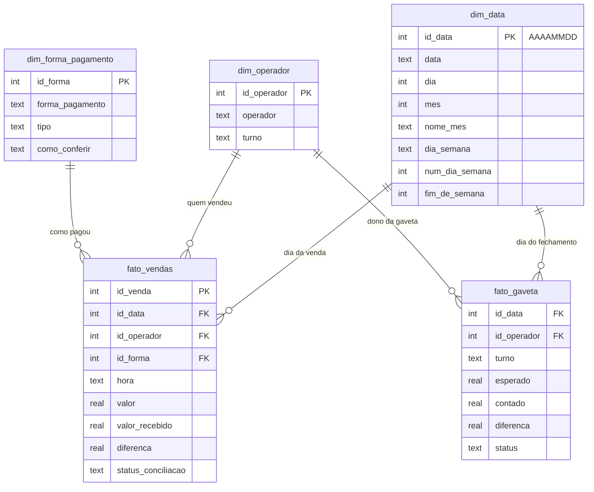

# Modelo estrela (Star Schema)

Na Etapa 3, os dados limpos e os resultados da conciliação vão para um banco
SQLite (`banco/caixa.db`), organizados em um **modelo estrela**.

## Diagrama



## O que é cada tabela

| Tabela | Tipo | Uma linha é... |
|---|---|---|
| `dim_data` | Dimensão | um dia de outubro/2026 |
| `dim_operador` | Dimensão | um operador de caixa (com o turno dele) |
| `dim_forma_pagamento` | Dimensão | Crédito, Débito, PIX ou Dinheiro |
| `fato_vendas` | Fato | uma venda do PDV, com o status da conciliação |
| `fato_gaveta` | Fato | o fechamento da gaveta de um operador em um turno |

Status possíveis em `fato_vendas.status_conciliacao`:

- **Conciliado**: a venda foi confirmada na maquininha ou no extrato do banco
- **Não consta na maquininha**: venda no cartão sem transação correspondente
- **PIX não recebido**: venda em PIX que não apareceu no extrato
- **Dinheiro**: venda em dinheiro, conferida pelo total do turno na `fato_gaveta`

## Por que modelo estrela?

Pense no fechamento de caixa: tem o **acontecimento** (a venda, o fechamento da
gaveta) e tem o **contexto** (quem, quando, como pagou).

- As **tabelas fato** guardam os acontecimentos e os números (valores em R$).
  São grandes (2.403 vendas) e repetem só as chaves, nunca os textos.
- As **tabelas dimensão** guardam o contexto, uma vez só. Se um operador mudar de
  turno, muda em um lugar e todas as vendas dele já "enxergam" a mudança.

Vantagens na prática:

1. **Consultas simples**: toda pergunta vira "fato + JOIN nas dimensões que eu
   preciso + GROUP BY". Ex.: diferença por dia da semana = `fato_vendas` +
   `dim_data`.
2. **Duas fatos, mesmas dimensões**: vendas e gaveta têm granularidades diferentes
   (uma venda x um turno), mas usam o mesmo calendário e os mesmos operadores, então
   dá para analisar as duas juntas.
3. **É o formato que o Power BI espera**: na Etapa 5, cada tabela vira uma tabela
   do Power BI e cada linha do diagrama vira um relacionamento 1:N. As dimensões
   viram os filtros (segmentações) e as fatos viram as medidas.

## Como gerar e consultar

```bash
python src/limpeza.py         # Etapa 1
python src/conciliacao.py     # Etapa 2
python src/carregar_banco.py  # Etapa 3 -> banco/caixa.db

sqlite3 -header -column banco/caixa.db < sql/02_consultas_conciliacao.sql
```

O arquivo `banco/caixa.db` não vai para o GitHub (está no `.gitignore`): ele é
gerado de novo a qualquer momento pelo script.
